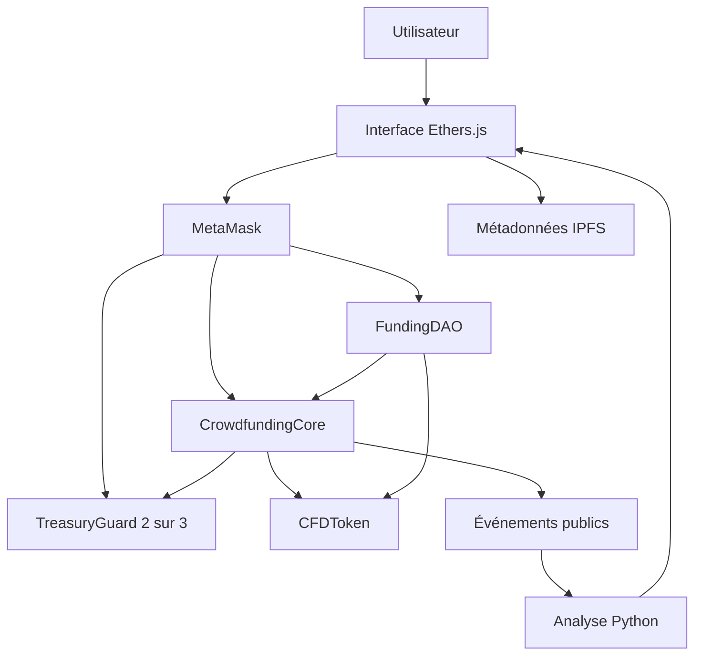

# Architecture et invariants

La clé privée reste dans le wallet. L’interface est remplaçable ; un appel direct aux contrats subit exactement les mêmes contrôles.

| Invariant | Mise en œuvre | Preuve |
|---|---|---|
| Une contribution positive crée exactement 1 000 unités CFD par unité wei | Core.contribute et token.mint réservé à Core | test M1, fuzzing |
| Les obligations financières restent couvertes | totalEscrow = somme des séquestres ; aucun retrait Admin | fuzzing, test multi-campagnes |
| Un retrait payé ne peut pas être payé deux fois | withdrawn avant appel externe + nonReentrant | tests retrait et réentrance |
| Un remboursement ne laisse pas de jetons correspondants | burn atomique avant transfert | tests remboursement et refus ETH |
| Un vote ne change pas de poids après création | ERC20Votes au bloc snapshot | tests après proposition et même bloc |
| Une majorité sans quorum ne suffit pas | oui+non ≥ quorum, oui > non | tests quorum et égalité |
| Un gros retrait exige deux personnes cryptographiques | deux adresses distinctes pour la même clé d’opération | tests multisig |

Sous transactions normales : `balance(Core) == totalEscrow`. En présence d’ETH forcé : `balance(Core) >= totalEscrow`. Une égalité absolue ne peut pas être garantie contre un transfert forcé ; ces fonds ne sont pas distribués arbitrairement.
